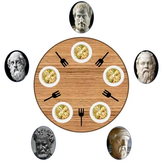
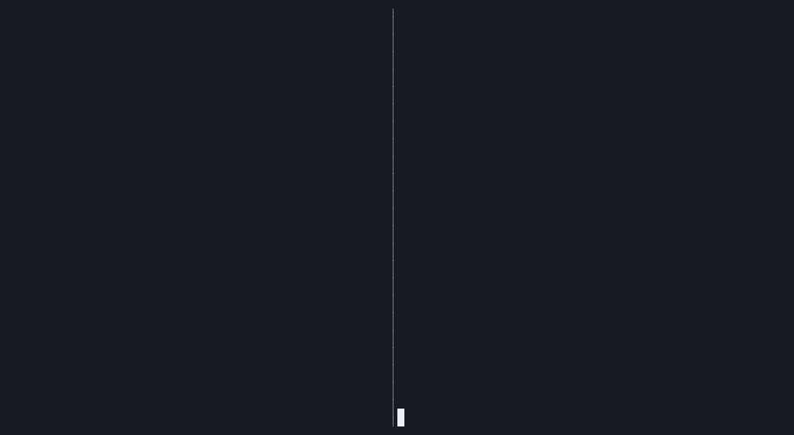
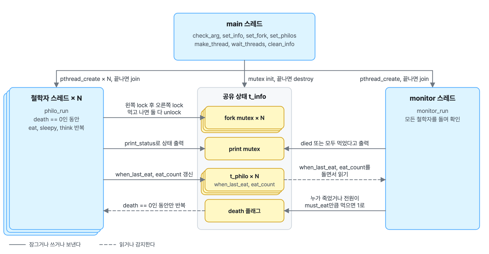
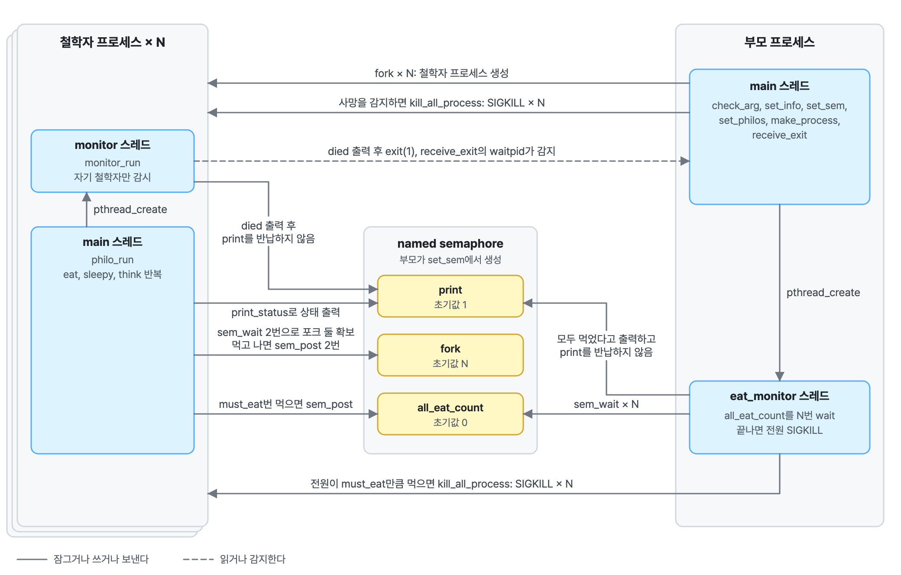

# philosophers



1965년에 에츠허르 다익스트라가 만든, [식사하는 철학자 문제](https://ko.wikipedia.org/wiki/%EC%8B%9D%EC%82%AC%ED%95%98%EB%8A%94_%EC%B2%A0%ED%95%99%EC%9E%90%EB%93%A4_%EB%AC%B8%EC%A0%9C)를 구현하는 [42서울 과제](docs/subject.md)입니다. 

둥근 탁자에 철학자 N명과 포크 N개가 있고, 각 철학자는 먹기, 자기, 생각하기를 반복하며 먹으려면 양옆의 포크 두 개를 모두 집어야 합니다. 양 옆의 포크를 누군가가 사용중이면 사용할 수 없습니다. 마지막 식사를 시작한 뒤 정해진 시간 안에 다시 먹지 못하면 죽고, 누군가 죽으면 시뮬레이션이 멈춥니다.

`philo`는, 철학자를 스레드로 만들고 포크마다 mutex를 하나씩 두어 두 철학자가 같은 포크를 동시에 집지 못하게 하는 과제입니다. 

`philo_bonus`는 보너스 과제로, 철학자를 프로세스로 만들고 포크는 메모리에 상태를 두지 않은 채 탁자 가운데 놓인 포크의 개수를 세마포어로 세는 과제입니다. 

두 프로그램을 실제로 실행해 검사하는 시나리오 테스트가 각 디렉터리의 tests/ 아래에 있습니다.




왼쪽은 philo를 실행한 실제 출력이고, 오른쪽은 그 출력을 기반으로 현재 상황을 보여주는 화면입니다.

왼쪽 출력은 한 줄이 `<시각> <철학자번호> <상태>` 형식이고, 시각은 시작부터 흐른 밀리초, 상태는 `has taken a fork`, `is eating`, `is sleeping`, `is thinking`, `died` 중 하나입니다.

## 아키텍처 다이어그램

### philo: 스레드와 mutex

main 스레드가 인자의 유효성을 검사하고 공유 상태를 초기화한 다음 철학자 스레드 N개와 monitor 스레드 하나를 만듭니다. 

철학자 스레드는 왼쪽과 오른쪽 포크 mutex를 차례로 잠그고 먹은 뒤, 자고, 생각하기를 반복합니다. 

monitor 스레드는 모든 철학자의 마지막 식사 시각과 식사 횟수를 확인하다가, 누군가 `time_to_die` 시간만큼 먹지 못했으면 `died`를, 모두가 정해진 횟수만큼 먹었으면 `all philosophers have eaten` 을 출력하고 `death` 플래그를 올립니다. 

`death` 플래그가 올라가면 모든 스레드가 루프를 빠져나오고, main 스레드가 join과 자원 정리를 맡습니다. 프로그램에서는 스레드별 출력 시 출력이 섞이지 않게 print mutex를 사용합니다.

<picture>
  <source media="(prefers-color-scheme: dark)" srcset="docs/philo-dark.webp">
  
</picture>

### philo_bonus: 프로세스와 세마포어

부모 프로세스가 named semaphore 세 개를 만들고 철학자 수만큼 프로세스를 만듭니다. 

포크는 mutex 배열 대신 철학자 수를 초기값으로 갖는 세마포어 하나이고, 철학자 프로세스는 sem_wait를 두 번 해서 포크 두 개를 얻습니다. 

사망 감시는 프로세스마다 들어 있는 monitor_run 스레드가 맡습니다. 자신의 철학자가 `time_to_die`를 넘기면 `died`를 출력하고 print 세마포어를 돌려주지 않은 채 exit 코드 1로 끝내므로, 다른 프로세스는 출력을 할 수 없습니다. 부모 프로세스는 waitpid로 exit 코드를 받아 나머지 프로세스를 SIGKILL로 정리합니다. 

식사 횟수는 `all_eat_count` 세마포어로 셉니다. 철학자가 정해진 횟수를 채우면 sem_post하고, 부모의 eat_monitor 스레드가 철학자 수만큼 sem_wait에 성공하면 print 세마포어를 잡은 채 `all philosophers have eaten`를 출력하고 모든 프로세스를 SIGKILL로 종료합니다.

<picture>
  <source media="(prefers-color-scheme: dark)" srcset="docs/philo_bonus-dark.webp">
  
</picture>

## 디렉터리 구조

```text
.
├── philo/                      스레드와 mutex 버전
│   ├── philo.h                 t_philo, t_info 구조체와 함수 선언
│   ├── 0_philo.c               main, 설정과 포크 mutex 초기화, 스레드 생성
│   ├── 1_routines.c            철학자 루틴 eat, sleepy, think와 monitor_run
│   ├── 2_utils.c               시간 측정, 상태 출력, ft_atoi
│   ├── 3_arg.c                 인자 검증
│   ├── 4_end.c                 모두 먹었다는 출력, 스레드 join과 자원 정리
│   ├── Makefile                all, test, clean, fclean, re
│   └── tests/
│       ├── test_arg.c          인자 검증 함수 단위 테스트
│       └── test_scenario.c     philo를 실행해 출력과 사망 시각을 검사하는 시나리오 테스트
├── philo_bonus/                프로세스와 세마포어 버전
│   ├── philo_bonus.h           구조체와 함수 선언
│   ├── 0_philo_bonus.c         main, 세마포어 생성, 철학자 프로세스 fork
│   ├── 1_routines_bonus.c      철학자 루틴과 프로세스별 monitor_run
│   ├── 2_utils_bonus.c         시간 측정, 상태 출력, 모두 먹었다는 출력
│   ├── 3_monitor_bonus.c       eat_monitor, 자식 종료 대기와 SIGKILL 정리
│   ├── 4_arg_bonus.c           인자 검증
│   ├── Makefile                all, test, clean, fclean, re
│   └── tests/
│       ├── test_arg_bonus.c    인자 검증 함수 단위 테스트
│       └── test_scenario_bonus.c  philo_bonus를 실행해 검사하는 시나리오 테스트
└── docs/
    ├── dining_philosophers_problem.webp  과제 소개 그림
    ├── demo.webp               위 데모
    ├── philo.webp              philo 아키텍처 다이어그램
    ├── philo-dark.webp         같은 그림의 다크 테마
    ├── philo_bonus.webp        philo_bonus 아키텍처 다이어그램
    ├── philo_bonus-dark.webp   같은 그림의 다크 테마
    └── subject.md              과제 원문 한글 번역
```

## 실행 방법

### 빌드

```sh
make -C philo
make -C philo_bonus
```

### 실행

```sh
./philo/philo 5 800 200 200 7
./philo_bonus/philo_bonus 5 800 200 200 7
```

인자는 순서대로 다음과 같고, 모두 int 범위의 양의 정수입니다. 시간 단위는 밀리초입니다.

| 인자 | 의미 |
| --- | --- |
| `number_of_philosophers` | 철학자 수. 포크 수와 같습니다. |
| `time_to_die` | 마지막 식사를 시작한 뒤 이 시간 안에 다시 먹기 시작하지 못하면 죽습니다. |
| `time_to_eat` | 한 번 먹는 데 걸리는 시간 |
| `time_to_sleep` | 한 번 자는 데 걸리는 시간 |
| `number_of_times_each_philosopher_must_eat` | 선택 인자. 모든 철학자가 이 횟수만큼 먹으면 그 사실을 출력하고 멈춥니다. 없으면 누군가 죽을 때까지 돕니다. |

출력은 `<시각> <철학자번호> <상태>` 형식으로 한 줄씩 나옵니다. 

시각은 시작 시점부터 흐른 밀리초이고, 상태는 `has taken a fork`, `is eating`, `is sleeping`, `is thinking`, `died` 다섯 가지입니다. 

모든 철학자가 정해진 횟수만큼 먹어서 멈출 때는 `1601 all philosophers have eaten 3 times`처럼 마지막 줄에 출력합니다. 

위 멘트나 `died`가 출력된 이후로는 아무것도 출력하지 않습니다. 

아래는 `./philo/philo 4 310 200 100`의 실제 출력입니다.

```text
0 1 has taken a fork
0 1 has taken a fork
0 1 is eating
0 3 has taken a fork
0 3 has taken a fork
0 3 is eating
200 3 is sleeping
200 4 has taken a fork
200 1 is sleeping
200 2 has taken a fork
200 2 has taken a fork
200 2 is eating
200 4 has taken a fork
200 4 is eating
300 1 is thinking
300 3 is thinking
310 3 died
```

### 테스트

```sh
make -C philo test
make -C philo_bonus test
```

각 디렉터리의 `make test`는 프로그램을 빌드한 다음 테스트 두 개를 차례로 실행합니다. 

